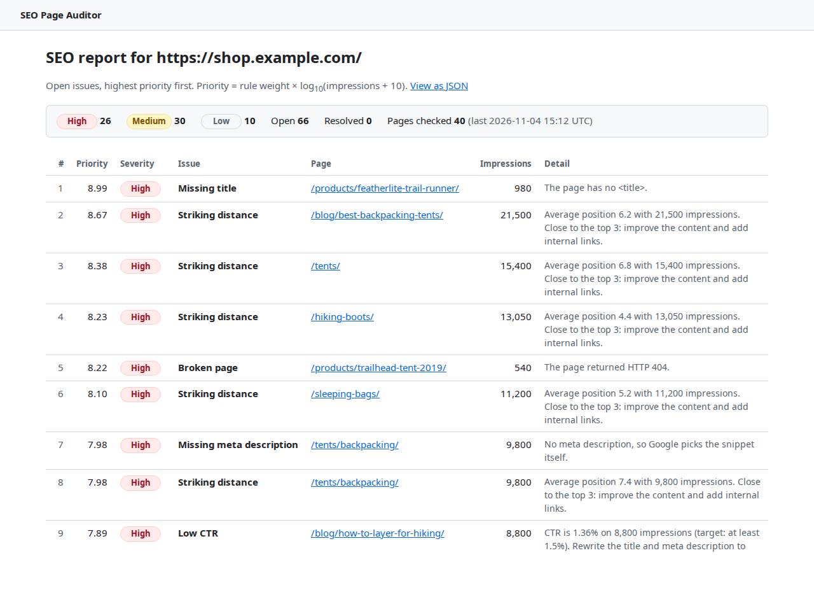

# SEO Page Auditor

[](https://github.com/0x051C/seo_page_auditor_django/actions/workflows/build-binary.yml)

A small Django app that pulls Google Search Console performance data, checks each page for basic on-page SEO problems, and produces a prioritised list of fixes. Problems on high-traffic pages rank first.



**How it works:**

```
import_gsc   -> PageMetric   clicks, impressions, CTR, position per page (Search Console API or sample data)
check_pages  -> PageCheck    status code, title, meta description, H1 count, word count, canonical
run_audit    -> Issue        rules flag problems and score their priority
                  |
                  +-> /sites/<id>/report/       HTML report
                  +-> /api/sites/<id>/issues/   JSON (Django REST Framework)
```

Built with Python 3.12+, Django 5.2, SQLite, Django REST Framework, requests, BeautifulSoup and google-api-python-client.

## Quick start (mock mode, no Google account needed)

Mock mode uses `sample_data/` (40 pages of a fictional outdoor-gear shop) for both the Search Console data and the page HTML. Nothing goes over the network.

```bash
git clone https://github.com/0x051C/seo_page_auditor_django.git
cd seo_page_auditor_django
python3 -m venv .venv
source .venv/bin/activate            # Windows: .venv\Scripts\activate
pip install -r requirements.txt
cp .env.example .env                 # GSC_BACKEND=mock is the default

python manage.py migrate
python manage.py import_gsc  --site https://shop.example.com/
python manage.py check_pages --site https://shop.example.com/
python manage.py run_audit   --site https://shop.example.com/
python manage.py runserver
```

Then open:

- http://127.0.0.1:8000/sites/1/report/ for the report
- http://127.0.0.1:8000/api/sites/1/issues/?severity=high for the JSON
- http://127.0.0.1:8000/admin/ for the admin (after `python manage.py createsuperuser`)

Run the tests with:

```bash
python manage.py test
```

## Standalone binary (Nuitka + zig cc)

The whole project, including Django and the Python runtime, can be compiled into one Linux executable that runs without Python installed. [Nuitka](https://nuitka.net/) translates the Python code into C, and [Zig](https://ziglang.org/)'s bundled clang (`zig cc`, through Nuitka's `--zig` option) compiles that C into a binary.

**Download:** every push to `main` runs the [Test and build binary](https://github.com/0x051C/seo_page_auditor_django/actions/workflows/build-binary.yml) workflow. Open the latest successful run and download the `seo-page-auditor-linux-x86_64` artifact. Artifacts are zipped, which drops the executable bit:

```bash
unzip seo-page-auditor-linux-x86_64.zip && chmod +x seo-page-auditor
```

**Use it** like `python manage.py`. The database (`db.sqlite3`) and an optional `.env` are read from the folder you run it in:

```bash
mkdir demo && cd demo
../seo-page-auditor migrate
../seo-page-auditor import_gsc  --site https://shop.example.com/
../seo-page-auditor check_pages --site https://shop.example.com/
../seo-page-auditor run_audit   --site https://shop.example.com/
../seo-page-auditor runserver
```

It is built on Ubuntu 24.04 (x86_64), so it needs a Linux system with a similarly recent glibc.

**Build it yourself:**

```bash
pip install -r requirements-build.txt     # Nuitka, ziglang (pinned Zig), zstandard, patchelf
scripts/build_binary.sh                   # writes build/seo-page-auditor (about 30 MB)
scripts/smoke_test_binary.sh              # runs the binary end to end in a temp folder
```

A build takes a few minutes. Django imports a lot of code by name at runtime (apps, migrations, template tags, the SQL compiler), which Nuitka cannot see by following imports, so [`scripts/build_binary.sh`](scripts/build_binary.sh) lists those packages explicitly. The smoke test catches anything missing: it runs the pipeline, serves the report, the API and static files, and logs into the admin. The build tools are in a separate `requirements-build.txt` because the app doesn't need them to run.

## Using real Search Console data

1. In Google Cloud, create a service account and download its JSON key. Enable the **Google Search Console API** for the project.
2. In Search Console, add the service account's email as a user (Restricted is enough) on your property.
3. In `.env`:
   ```
   GSC_BACKEND=google
   GOOGLE_APPLICATION_CREDENTIALS=/path/to/service-account.json
   ```
4. Run the same three commands with your property URL, e.g. `--site https://www.yoursite.com/`. With `GSC_BACKEND=google`, `check_pages` fetches the real pages over HTTP, at most one request per second.

The `--site` value must be a URL-prefix property exactly as it appears in Search Console.

## Configuration

All settings come from environment variables, loaded from `.env` by python-dotenv. `.env` is git-ignored.

| Variable | Default | Purpose |
|---|---|---|
| `GSC_BACKEND` | `mock` | `mock` reads `sample_data/gsc_sample.json`; `google` calls the API |
| `GOOGLE_APPLICATION_CREDENTIALS` | (empty) | Service-account key file, needed for `google` |
| `PAGE_FETCHER` | follows `GSC_BACKEND` | `mock` builds pages from `sample_data/pages_sample.json`; `http` fetches them |
| `PAGE_FETCH_TIMEOUT` | `10` | Seconds before a page request gives up |
| `PAGE_FETCH_DELAY` | `1` | Minimum seconds between page requests |
| `PAGE_FETCH_USER_AGENT` | `SEOPageAuditor/0.1 (+repo URL)` | User-Agent sent with each request |
| `DJANGO_DEBUG` | `1` | Set to `0` outside local development |
| `DJANGO_SECRET_KEY` | dev placeholder | Required when `DJANGO_DEBUG=0` |
| `DJANGO_ALLOWED_HOSTS` | `localhost,127.0.0.1` | Comma-separated |

## Command reference

| Command | What it does |
|---|---|
| `python manage.py import_gsc --site URL [--days 28]` | Imports page-level clicks, impressions, CTR and average position for the last N days. The window ends 3 days ago because recent Search Console data is incomplete. Creates the `Site` if needed. Safe to re-run: the same date range updates existing rows instead of adding new ones. |
| `python manage.py check_pages --site URL [--limit N]` | Fetches every imported page, highest impressions first, and stores one `PageCheck` per page (status code, title, meta description, H1 count, word count, canonical). `--limit` checks only the top N pages. |
| `python manage.py run_audit --site URL` | Runs the rules over each page's latest metrics and check, then syncs `Issue` rows: creates new issues, updates existing ones, reopens issues that came back, and marks issues that no longer apply as resolved. |

## Web pages and API

| URL | Description |
|---|---|
| `/` | List of sites with links to their reports |
| `/sites/<id>/report/` | Open issues by priority, with severity counts. Plain template, no JavaScript. |
| `/api/sites/<id>/issues/` | Open issues as JSON, highest priority first. Read-only. |
| `/admin/` | Django admin for all four models, with filters and search |

API filters, which can be combined (values are case-insensitive, and an unknown value returns `400`):

- `?severity=high|medium|low`
- `?rule=LOW_CTR|STRIKING_DISTANCE|MISSING_TITLE|TITLE_TOO_LONG|MISSING_META_DESC|NO_H1|MULTIPLE_H1|THIN_CONTENT|BROKEN_PAGE`

```
GET /api/sites/1/issues/?severity=high&rule=BROKEN_PAGE

[
  {
    "id": 51,
    "page_url": "https://shop.example.com/products/trailhead-tent-2019/",
    "rule": "BROKEN_PAGE",
    "rule_label": "Broken page",
    "severity": "high",
    "priority": 8.22,
    "detail": "The page returned HTTP 404.",
    "detected_at": "2026-11-04T15:08:09.209972Z",
    "resolved": false
  }
]
```

## Rules

All rules are in [`audit/rules.py`](audit/rules.py) as pure functions: plain values in, a `Finding` or `None` out, with no database or network access.

| Rule | Triggers when | Weight |
|---|---|---|
| `BROKEN_PAGE` | status code is 400 or higher, or the request got no response | 3 |
| `MISSING_TITLE` | the title is empty | 3 |
| `LOW_CTR` | impressions >= 500 and CTR < 1.5% | 2 |
| `STRIKING_DISTANCE` | average position from 4 to 10 (inclusive) and impressions >= 200 | 2 |
| `MISSING_META_DESC` | the meta description is empty | 2 |
| `NO_H1` | there is no `<h1>` | 2 |
| `THIN_CONTENT` | fewer than 300 words | 2 |
| `TITLE_TOO_LONG` | the title is over 60 characters | 1 |
| `MULTIPLE_H1` | there is more than one `<h1>` | 1 |

On-page rules are skipped for broken pages, because an error page's title and word count say nothing about the real page.

## Severity formula

Each issue gets a priority score, and its severity comes from that score:

```
priority = weight × log10(impressions + 10)

severity = high    if priority >= 7
           medium  if priority >= 5
           low     otherwise
```

- **weight** (1 to 3, see the table above) is how bad the problem is on its own: 3 means the page is broken or invisible in results, 2 means it is losing clicks or rankings, and 1 is cosmetic.
- **impressions** come from the page's most recent Search Console row.
- **log10** is used because impressions span orders of magnitude. A page with 10,000 impressions should rank above one with 100, but not 100 times higher.
- **+10** means a page with zero impressions still scores `weight × 1`, so it is never zero.

What that means in impressions:

| Weight | Medium from | High from |
|---|---|---|
| 3 (broken page, missing title) | ~36 | ~205 |
| 2 (low CTR, striking distance, meta, H1, thin) | ~306 | ~3,150 |
| 1 (long title, multiple H1s) | ~100,000 | ~10,000,000 |

The report and the API sort by the score itself, so within a severity level the page with more traffic comes first. The formula is tested in [`audit/tests/test_rules.py`](audit/tests/test_rules.py).

## Project layout

```
config/                 Django project: settings (env-driven), root URLs
audit/
  models.py             Site, PageMetric, PageCheck, Issue
  gsc.py                SearchConsoleBackend interface, MockBackend, GoogleBackend
  pagecheck.py          parse_html() (pure), HttpFetcher, MockFetcher
  rules.py              rule functions, priority_score(), severity_for() (pure)
  services.py           import_metrics(), check_pages(), run_audit(): the database writes
  management/commands/  import_gsc, check_pages, run_audit (argument parsing and output)
  views.py              report page and DRF list view
  tests/                unit, command and view tests, plus HTML fixtures
sample_data/            mock Search Console response and mock page specs
scripts/                build_binary.sh (Nuitka + zig cc), smoke_test_binary.sh
.github/workflows/      CI: tests, then build, smoke-test and upload the binary
```

## Design notes

- **Idempotent import.** `PageMetric` has a unique constraint on `(site, page_url, date_start, date_end)`, and the importer writes with `update_or_create` using the same four fields. Re-running an import finds the existing row and updates it, so the row count stays the same. The constraint is the safety net: the database itself refuses a duplicate. `PageCheck` (one per page) and `Issue` (one per page and rule) work the same way.
- **Pure rules.** The rule functions in `rules.py` take plain values and have no side effects, so tests call them directly without a database (`SimpleTestCase`), and each rule has a trigger test and an edge-case test.
- **One interface, two backends.** `MockBackend` and `GoogleBackend` both subclass `SearchConsoleBackend` and implement `fetch_page_metrics(site_url, start, end)`. The importer only calls that method. The mock JSON has the same shape as a real API response, so both backends share `rows_from_response()`.
- **Testable fetching.** `HttpFetcher` takes its session, `sleep` and `clock` as arguments, so tests check the User-Agent, timeout and 1-request-per-second limit without network access or real waiting.
- **Thin commands.** Management commands only parse arguments and print. The work happens in `services.py`, which tests call directly.

## What I'd improve next

- **Scale to many sites.** Move import, check and audit into a task queue (Celery or RQ) on a schedule, with one job per site and a per-host rate limit, so sites run in parallel without hammering any one server. Switch to PostgreSQL for concurrent writes. Replace per-row `update_or_create` with `bulk_create(update_conflicts=True)`, which is one query per batch instead of two per row. Resolve stale issues by a `last_seen_at` timestamp instead of a growing `pk__in` list.
- **Query-level data.** Import the `query` dimension as well as `page`, to show which keywords a striking-distance page should target.
- **Better page checks.** Count only main-content words instead of nav and footer text, record redirects instead of following them silently, respect `robots.txt`, and discover pages from the sitemap as well as from Search Console.
- **History.** Keep every `PageCheck` and metric period, so the report can show trends and when an issue was fixed.
- **Domain properties.** Support `sc-domain:` Search Console properties as well as URL-prefix ones.
- **More platforms.** Build the binary for macOS and Windows as well, and attach binaries to tagged GitHub releases.
